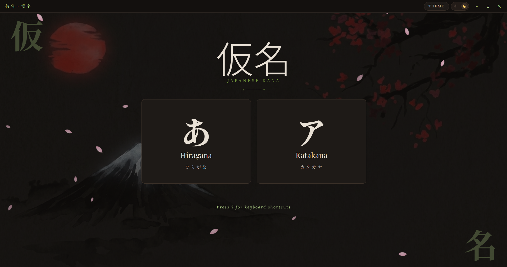

<div align="center">

# 🌸 Kana Learning App (仮名)
### *A Distraction-Free, Aesthetic, Fully Offline Japanese Kana Learning Suite*

[](https://github.com/Devil-MockerXD/Kana-Learning-App)
[](https://www.electronjs.org/)
[](https://nodejs.org/)
[](https://github.com/Devil-MockerXD/Kana-Learning-App)
[](#-fully-offline)
[](LICENSE)

<br />

**Kana Learning App** is a fast, elegant desktop application built with Electron and Node.js for mastering Japanese **Hiragana (ひらがな)** and **Katakana (カタカナ)**: animated stroke order, native-style audio, adaptive quizzes, light & dark themes with six accent colours, and full keyboard control. Once set up, it needs no internet connection.

[✨ Features](#-features) • [🆕 What's New in 2.1](#-whats-new-in-21) • [🚀 Quick Start](#-getting-started) • [📴 Offline](#-fully-offline) • [⌨️ Shortcuts](#%EF%B8%8F-keyboard-shortcuts) • [🗺️ Roadmap](#%EF%B8%8F-roadmap)

---

</div>

## 🌟 Overview

Whether you are starting your Japanese journey or brushing up on tricky combination and extended sounds, **Kana Learning App** combines a complete character reference, stroke-order animations, audio pronunciation, quizzes with lifetime analytics, and a calm washi-inspired interface you can tint to your taste, all controllable from the keyboard.

---

## 🆕 What's New in 2.1

- ✍️ **Stroke-order animations** for every kana, including combos and extended sounds
- 🎨 **Light & Dark modes** with Mt. Fuji backgrounds, plus **6 accent colours** (new **Theme** picker in the titlebar)
- ⌨️ **Full keyboard navigation**: arrow keys, Enter/Space, single-key shortcuts and a `?` cheat-sheet
- 📴 **Fully offline**: audio clips and web fonts are stored locally, so the app makes no network requests
- 🔁 Theme chosen on the splash screen now carries into the main window
- 🧹 Removed the old font selector and size slider; removed the "Esc to go back" hints (Esc still works)
- 🛠️ Quiz fix: a correct answer's auto-advance timer could skip the next question; it is now cancelled properly

---

## ✨ Features

### 🈸 1. Complete Japanese Syllabary Coverage
* **All 46 Basic Hiragana & Katakana (五十音 / Gojūon)**
  * All vowels (*a, i, u, e, o*), consonant rows (*K, S, T, N, H, M, Y, R, W*) and the nasal *n*.
* **25 Voiced & Semi-Voiced Characters (濁音 & 半濁音 / Dakuten & Handakuten)**
  * *G, Z, D, B* (dakuten `゛`) and *P* (handakuten `゜`).
* **33 Contracted Sounds (拗音 / Yōon)**
  * Glides with small *ya (ゃ/ャ)*, *yu (ゅ/ュ)*, *yo (ょ/ョ)* (*kya, sha, cha, nya, hya, rya*, …).
* **Extended Foreign Loanword Sounds (外来語 / Gairaigo)**
  * Modern combinations such as *fa, fi, fe, fo, va, vi, vu, ve, vo, ti, tu, di, du, wi, we, wo, she, je, che, ye*.
* **Standard / Extended pages** on both the Hiragana and Katakana charts, switchable with a tab bar or the `1` / `2` keys.

---

### ✍️ 2. Stroke-Order Animations
* **Animated writing**: strokes are drawn one after another with the current stroke highlighted and its number shown, over a faint ghost of the whole character.
* **Covers all 160 characters** the app uses (basic, dakuten, handakuten, small kana, ゔ/ヴ). Combos like きゃ animate each part side by side.
* **Controls**: **Replay**, **Step ›** (one stroke at a time) and **Speed** (Slow / Normal / Fast, remembered between sessions).
* **Open it with the ✎ icon** on any tile, or press `S` on a focused tile.
* **Respects reduced-motion** system settings.
* Fully offline: stroke data ships with the app (derived from [KanjiVG](http://kanjivg.tagaini.net), CC BY-SA 3.0).

---

### 🔊 3. Offline Audio Engine
* **Pre-recorded pronunciation clips** play from a local `audio/` folder: no streaming, no network.
* **One-time setup**: run `npm run fetch-audio` once while online to download the ~136 clips; after that everything is offline. It resumes if interrupted and skips files you already have.
* **Shared clips**: Katakana reuse the matching Hiragana clip, so each sound is stored once.
* **Smart fallback**: if a clip is missing, the app uses your operating system's Japanese voice (`ja-JP`) at a slower, clearer pace, which also works offline when a Japanese voice is installed.
* **Visual sound indicators**: sound badge, tile glow and a subtle pulse whenever audio plays.
* **Click-to-hear everywhere**: any tile in the charts, plus a dedicated listen button in quizzes (`Alt+L`).

---

### 🎨 4. Themes & Accent Colours
* **Light & Dark modes**: toggle with the sun/moon pill in the titlebar (or the splash screen, or press `T`). Your choice is remembered and applied before the page paints, so there's no flash.
* **Mt. Fuji backdrops**: a separate artwork for light and dark mode on every page.
* **Six accent colours** via the **Theme** button in the titlebar (press `C` to cycle):

  | Accent | Name |
  | :--- | :--- |
  | 🟧 | **Shu 朱** (Vermillion, the original) |
  | 🌸 | **Sakura 桜** (Pink) |
  | 🍵 | **Matcha 抹茶** (Green) |
  | 🔵 | **Ai 藍** (Indigo) |
  | 🪻 | **Fuji 藤** (Wisteria) |
  | 🌊 | **Asagi 浅葱** (Teal) |

* **Tuned per theme**: every accent has a light-mode and dark-mode shade for good contrast.
* **Colours only, not cards**: the accent changes borders, highlights, glows and muted text, while card and tile backgrounds stay the same. Wrong-answer feedback always stays red.
* **Remembered and synced** across the splash and main windows.

---

### 🌸 5. Zen Atmosphere
* **Falling Sakura (桜) petals** with randomized size, speed and sway drifting behind the home page.
* **Curated typography** (bundled locally):
  * Japanese: *Shippori Mincho B1*, *Noto Serif JP*
  * Latin headings & body: *Playfair Display*, *Lora*, *Cormorant Garamond*
* **Interactive determination splash**: *"Are you determined to learn? 頑張る気持ちはありますか？"* with an instant, smooth hand-off into the app.
* **Frameless minimalist titlebar** with draggable area, window controls, theme toggle and accent picker.
* **Subtle motion** throughout (page fades, hover glows), reduced for users who prefer less animation.

---

### 🧠 6. Interactive Quiz & Mastery Analytics
* **Customizable sessions**:
  * **Question limits**: **10**, **15**, **25**, **50** or **All**.
  * **Character filters**: **Basic (46)**, **Dakuten (25)**, **Combos (33)** or **All (104+)**.
* **Hiragana and Katakana quizzes** with identical engines and separate statistics.
* **Instant romaji validation**: green for correct, red for mistakes, with the correct reading shown immediately.
* **Listen button** and click-to-hear on the quiz character.
* **Auto-advance** after a correct answer, or press Enter to move on yourself.
* **Session breakdown**: questions, correct, wrong, score and time taken.
* **Lifetime records**: total games, total questions, total correct and best score.
* **Progress chart**: animated bars showing how your sessions spread across Beginner → Perfect.
* **Mistake review table**: target character, your answer and the correct pronunciation.
* **Encouragement banners** in Japanese (*Kanpeki! 完璧*, *Taihen Yoku Dekimashita! 大変よくできました*, …).
* **Your data stays on your device** (stored locally, nothing is uploaded).

---

### ⌨️ 7. Full Keyboard Control
* **Arrow keys** move between tiles, cards, quiz options and buttons, always to the nearest one in that direction.
* **Enter / Space** act like a click on the focused item.
* **Enter with nothing focused** triggers the page's main action (Start Quiz, Next, Play Again, Haiii!, …).
* **Visible focus ring** in your accent colour (shown for keyboard use only).
* **Smart Tab order**: one stop on the chart, so you reach the Quiz link without tabbing through 100+ tiles.
* **In-app cheat-sheet**: press `?` on any page. See the [shortcuts table](#%EF%B8%8F-keyboard-shortcuts) below.

---

### 📴 8. Fully Offline
* **No online requests at runtime**: fonts are bundled, stroke data is bundled, and audio plays from local files.
* The only step that needs internet is the optional, one-time `npm run fetch-audio` (and `npm install`).
* Without the audio clips the app still works offline using your system's Japanese voice.

---

## 📸 Home Screen Preview



---

## ⌨️ Keyboard Shortcuts

| Shortcut | Context | Action |
| :--- | :--- | :--- |
| <kbd>?</kbd> | Any page | Show / hide the shortcut cheat-sheet |
| <kbd>T</kbd> | Any page | Toggle light / dark mode |
| <kbd>C</kbd> | Any page | Cycle accent colour |
| <kbd>Esc</kbd> | Anywhere | Context-aware back (Stroke window → Results → Setup → Chart → Home) |
| <kbd>←</kbd> <kbd>↑</kbd> <kbd>↓</kbd> <kbd>→</kbd> | Any page | Move between tiles, cards and options |
| <kbd>Enter</kbd> / <kbd>Space</kbd> | Focused item | Activate it (play sound, open card, select option) |
| <kbd>Tab</kbd> | Any page | Move through buttons and the titlebar |
| <kbd>H</kbd> / <kbd>K</kbd> | Home | Open Hiragana / Katakana |
| <kbd>S</kbd> | Kana chart (tile focused) | Open stroke-order animation |
| <kbd>1</kbd> / <kbd>2</kbd> | Kana chart | Standard / Extended page |
| <kbd>Q</kbd> | Kana chart | Open the quiz |
| <kbd>1</kbd>–<kbd>5</kbd> | Quiz setup | Choose number of questions |
| <kbd>Enter</kbd> | Quiz setup (nothing focused) | Start quiz |
| *Any letter* | During a quiz | Jump straight to the answer box |
| <kbd>Enter</kbd> | During a quiz | Submit answer / next question |
| <kbd>Alt</kbd>+<kbd>L</kbd> | During a quiz | Listen to the sound |
| <kbd>Space</kbd> / <kbd>Enter</kbd> | Stroke-order window | Replay |
| <kbd>→</kbd> | Stroke-order window | Next stroke |
| <kbd>Enter</kbd>, <kbd>←</kbd> <kbd>→</kbd>, <kbd>Esc</kbd> | Theme picker | Open, choose a colour, close |
| <kbd>Enter</kbd> | Splash screen | "Haiii~!!" |

---

## 🚀 Getting Started

### Prerequisites
[Node.js](https://nodejs.org/) (version 18 or higher recommended).

### Installation

1. **Clone the repository:**
   ```bash
   git clone https://github.com/Devil-MockerXD/Kana-Learning-App.git
   cd Kana-Learning-App
   ```

2. **Install dependencies:**
   ```bash
   npm install
   ```

3. **Download the audio clips (one time, needs internet):**
   ```bash
   npm run fetch-audio
   ```
   Re-run it any time to fill in missing clips. Use `npm run fetch-audio -- --force` to re-download everything.

4. **Launch the application:**
   ```bash
   npm start
   ```

> The Fuji background images live in `assets/` (`fuji-light.jpg`, `fuji-dark.jpg`). Keep that folder next to the HTML files.

---

## 📦 Building Executables

Fetch the audio **before** building so the clips are packaged inside the app.

| Platform | Command | Output Destination |
| :--- | :--- | :--- |
| **Windows** (x64) | `npm run build-win` | `dist/JapaneseKana-win32-x64/` |
| **macOS** (x64) | `npm run build-mac` | `dist/JapaneseKana-darwin-x64/` |
| **Linux** (x64) | `npm run build-linux` | `dist/JapaneseKana-linux-x64/` |

---

## 📂 Project Architecture

```plaintext
Kana-Learning-App/
├── main.js              # Electron main process & window lifecycle (splash → main)
├── preload.js           # Secure contextBridge IPC bridge
├── index.html           # Landing hub with sakura petals & script selection
├── splash.html          # Interactive startup screen with theme toggle
├── hiragana.html        # Hiragana chart (Standard + Extended)
├── katakana.html        # Katakana chart (Standard + Extended)
├── quiz.html            # Hiragana quiz with analytics & mistake review
├── quiz_katakana.html   # Katakana quiz with analytics & mistake review
├── audio.js             # Offline audio player with system-voice fallback
├── stroke.js            # Stroke-order animation window
├── strokes.js           # Stroke path data for all kana (from KanjiVG)
├── keys.js              # Keyboard navigation, shortcuts & cheat-sheet
├── accent.js            # Accent colour system & titlebar Theme picker
├── theme-init.js        # Early light/dark initialisation (no flash on load)
├── darkmode.js          # Theme styling engine (light + dark)
├── backgrounds.js       # Theme-aware Mt. Fuji backdrops
├── titlebar.js          # Custom frameless draggable titlebar
├── nav.js               # Esc-key back navigation
├── assets/              # fuji-light.jpg, fuji-dark.jpg
├── fonts/               # Bundled web fonts (woff2) + fonts.css + licenses
├── audio/               # Pronunciation clips (created by npm run fetch-audio)
├── tools/
│   └── fetch-audio.js   # One-time audio downloader
├── icon.ico             # Application icon
└── package.json         # Scripts, dependencies, and metadata
```

---

## 🙏 Credits & Licenses

* **Stroke-order data**: derived from [KanjiVG](http://kanjivg.tagaini.net) © Ulrich Apel and contributors, licensed [CC BY-SA 3.0](http://creativecommons.org/licenses/by-sa/3.0/). `strokes.js` remains under that licence.
* **Fonts**: Noto Serif JP, Shippori Mincho B1, Playfair Display, Lora and Cormorant Garamond, each under the SIL Open Font License 1.1 (see `fonts/OFL-*.txt`), packaged via [Fontsource](https://fontsource.org).
* **Audio clips** are not stored in this repository. `tools/fetch-audio.js` downloads them to your machine; if you redistribute a build that includes them, make sure the source you fetch from permits it.
* Application code: MIT License.

---

## 🗺️ Roadmap

- [x] ~~Stroke-order animations~~ *(shipped in 2.1)*
- [x] ~~Custom accent colours~~ *(shipped in 2.1)*
- [ ] **Handwriting Practice Canvas**: draw each kana yourself and get accuracy feedback.
- [ ] **Spaced Repetition System (SRS)**: adaptive Leitner / SM-2 scheduling driven by your quiz mistakes.
- [ ] **Confusable-Pairs Drill**: targeted practice for シ/ツ, ソ/ン, ぬ/め and similar look-alikes.
- [ ] **Kanji (漢字) Reference & Flashcards**: N5 to N1 progression.
- [ ] **Vocabulary & Essential Phrases** with kana breakdowns.
- [ ] **Audio Speed & Pitch Controls**: variable playback speeds.
- [ ] **More Themes**: Kyoto bamboo forest and Tokyo neon night.

---

## 🤝 Contributing

Contributions, feature suggestions, and pull requests are welcome!

1. Fork the Project
2. Create your Feature Branch (`git checkout -b feature/AmazingFeature`)
3. Commit your Changes (`git commit -m 'Add some AmazingFeature'`)
4. Push to the Branch (`git push origin feature/AmazingFeature`)
5. Open a Pull Request

---

## 📄 License

Distributed under the **MIT License**. See `LICENSE` for more information. Third-party data and fonts keep their own licences (see [Credits](#-credits--licenses)).

<div align="center">

---

*Made with ❤️ for Japanese learners around the world • 頑張ってください！*

</div>
